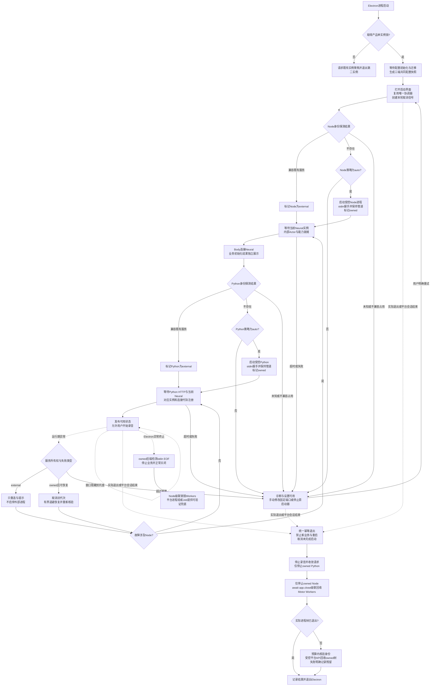

# 桌面后端托管与注册健康管理 Implementation Plan

> **For Claude:** REQUIRED SUB-SKILL: Use superpowers:executing-plans to implement this plan task-by-task.

**Goal:** Electron 作为产品唯一入口，按顺序检测/启动 Node 与 Python，确认对应实例的 Neural 注册，退出时只回收自己托管的进程树。

**Architecture:** Electron 主进程协调独立后端进程，以 owned/external 区分控制权限；实例契约、进程启动器与纯协调逻辑分离。ownerToken 只经 stdin 首次下发，管道持续保留以检测父进程失联；Neural 连接代际保护先于真实服务集成。

**Tech Stack:** Electron、TypeScript、NestJS、Socket.IO、Python/FastAPI/Uvicorn；现有 Yarn workspace、Node test runner、pytest。本计划不指定新增第三方进程管理库，平台适配可行性须先验证。

## 来源与关联需求

- 正式需求：桌面后端托管与注册健康管理；Beads `human-lf5`（P2）。当前仅规划，未批准代码实施，不 claim、不迁 `进行/`。
- 提出：[桌面后端托管与注册健康管理-提出](/Users/zhou/Desktop/obsidian/work/工程/规划中/秘书自动化/功能/讨论/P2-桌面后端托管与注册健康管理-261114/桌面后端托管与注册健康管理-提出.md)。
- 讨论：[桌面后端托管与注册健康管理-讨论稿](/Users/zhou/Desktop/obsidian/work/工程/规划中/秘书自动化/功能/讨论/P2-桌面后端托管与注册健康管理-261114/桌面后端托管与注册健康管理-讨论稿.md)，v2 正文与 ZCode/AGY 评审；本文采纳条款及事实校正见下一节。讨论中的原始意见保留历史，不把错误量化当现行要求。
- 衍生自：无来源（全新提出，沿用原需求）。使用：现有 Neural Actor/Capability、Body 配置与声明式 IPC、Python 听觉会话。边界：复用接口判据，不导入开发期清理脚本；对应能力历史 issue 待确认。
- 软关联：`human-3nn` 开发清理、`human-eup` 开发就绪门槛。`human-ryp` 已关闭，Body 在 `b3efdcb` 起直接纳入主仓库，不再以 patches 交付。
- 被衍生 / 被使用：无新增。硬前置：规划无；编码时 A 的实例关联契约阻塞 B 的真实就绪判断，后续平台能力按本计划依赖拆入 Beads，不能只标为软关联。
- 代码阅读基线：`b3efdcb`。实施前重新记录 HEAD、工作区状态及实际库版本；路径为仓库相对路径。下列“新增”文件与命令均为未来实施要求，不是已存在能力。

## 设计决议与事实校正

1. 产品在创建服务协调器前取得 `requestSingleInstanceLock()`；失败实例不得连接/启动后端，只请求第一实例显示窗口并退出。开发默认也单实例；独立多实例实验必须隔离 userData、端口和服务身份，不作为首期交付。
2. 自动托管 `auto` 与仅连接 `connect-only` 为持久化策略；“重启本项目服务”为显式操作。未知/不兼容占用不杀，external 不自动重启。首期不具备可靠 OS 身份映射的平台拒绝重启 external，提示停止原启动器。
3. ownerToken 仅从 Electron 经 owned 子进程 stdin 下发；不进 env、argv、identity、设置或日志。stdin 保持开放，EOF 触发幂等正常退出。此约束减少泄露，不声称抵御同用户任意内存/调试访问。
4. Neural 实例关联及连接代际是 A 首交付物，不能等字段不足再补。旧连接的断开、心跳、能力注册、订阅和响应不能修改新连接状态。
5. 本机 python-socketio 为 5.17.0：`connect(retry=False)` 是默认值，当前调用未传 retry，因此首次失败无自动重试；已连接后的掉线有最多 10 次内建重连。`reconnection_delay=3000` 单位是秒，又受默认 max=5 秒裁剪并带抖动，不能写成“10×3s=30s”。实施时显式关闭内建重连，由一个可取消循环统一接管首次连接与掉线恢复。
6. 产品禁止 shell `lsof/kill/pkill`、导入/执行 dev-cleanup 及按端口直接终止。只允许平台适配器对经过所有权和启动身份校验的自有进程使用受控进程 API；不能全局禁用 `ChildProcess.kill()`。现有开发清理已有工程归属检查，不能描述成任意占用者都杀。
7. 普通退出使用 before-quit 幂等清理；系统注销/关机可能不触发同一事件，平台会话事件及父管道失联另行覆盖，不承诺系统强杀下始终优雅完成。
8. ASR 资源大小、冷启动和分发验证与 B 并行，结果决定随包/独立模型包/首次下载策略；不得预设 GB 量级或把含下载的方案称为完整离线安装。

## 合同草案（A 阶段以测试冻结）

### 配置与权威来源

```ts
type ServiceName = 'node' | 'python'
type Policy = 'auto' | 'connect-only'
interface LifecycleConfig {
  schemaVersion: 1
  node: { policy: Policy; host: '127.0.0.1'; port: number }
  python: { policy: Policy; host: '127.0.0.1'; port: number }
}
```

端口为 1..65535 整数且不重复；默认 Node 12002、Python 12003。开发环境覆盖 → 持久化配置 → 默认值；启动页显示来源。旧 `nest_port`、`nest_folder_path` 迁移一次，旧字段作为兼容输入，禁止继续双向独立写入。受控运行时路径不接受渲染器任意命令。

Node 实际监听、Python 的 Neural URL、Body HTTP/WS 目标均从这一个配置快照派生。改固定端口需先预检、再显式应用，owned 服务按依赖顺序停止重启，external 只提示用户同步调整。失败保留可进入设置的诊断状态，不自动递增端口或伪报迁移成功。

### 服务与连接身份

`GET /runtime/identity` 建议返回版本化结构：`protocolVersion/serviceType/serviceVersion/deploymentId/instanceId/startedAt/pid`，Node 另带每次启动唯一 `neuralInstanceId`。身份不含 token，pid 不是杀进程凭据。部署标识与发行清单兼容规则一起冻结。

Actor 当前注册至少关联 `(neuralInstanceId, actorId, serviceInstanceId, connectionId)`；connectionId 由服务器从 socket 获取，不信任客户端自报。内部 Actor 关联本 Node 实例；Python、Body 通过启动身份和握手关联。就绪查询返回当前注册代际，可按实例过滤。拒绝冲突实例静默接管同名 Actor；同服务实例合法重连可替换旧连接，旧回调随后到达必须无副作用。跨实例接管需明确策略，首期默认冲突而非自动断开合法外部会话。

能力、订阅、心跳和断开清理均限定当前连接代际。HTTP 客户端如不能证明其 Python instanceId 与注册记录相同，则不能宣告 hearing ready。旧版无实例字段的服务显示不兼容，不降级为只按 actorId 判断。

### 父子管道与停止协议

stdin 用有长度上限的 UTF-8 NDJSON。第一条建议为 `{type:'bootstrap', protocolVersion:1, ownerInstanceId, ownerToken, expectedServiceInstanceId, neuralUrl}`；token 随机生成，仅驻内存。无秘密的启动标志可声明 owned；在握手前设置短超时，超限/格式错/EOF 即退出，不得进入采集。之后维持管道开放，由子进程持续读 EOF；日志 stdout/stderr 使用独立通道和脱敏规则。

认证的 `POST /runtime/shutdown` 只触发幂等收敛；202 接受响应不等于 exit。token 通过受校验的请求头发送，仅回环管理接口可用，独立于宽松业务 CORS，拒绝跨源和无凭据调用；日志隐藏头。external 无本实例 token，不能自动使用此接口。Node 以统一 shutdown → await app.close() 触发 Motor 清理；Python 通过受控 Uvicorn runner 的 should_exit/lifespan 退出，不能只停 WS 或在路由回调直接强退。

## 任务与依赖（静态执行计划，不替代 Beads 状态）

每项执行采用“写行为测试 → 确认失败原因 → 最小实现 → 运行定向验证 → 提交”的步骤。遇到契约变化先回修讨论与本计划。实施前将最小任务登记为 human-lf5 子任务，依赖方向为前置 → 后续；不在本文维护完成勾选框。

### A1：实例关联与旧连接保护——首交付物

**修改：** `apps/backend/src/neural/interfaces/index.ts`、`neural-core/neural-core.service.ts`、`neural-ws/neural-ws.gateway.ts`、`neural-http/neural-http.service.ts`、`neural-http/neural-http.controller.ts`（均在 neural 目录内）；Body/Python 注册消费方同步适配见 B。

**新增测试：** `apps/backend/scripts/neural-instance-smoke.ts`，并在 `apps/backend/package.json` 注册 `verify:neural-instances`。

1. 首先写 S1 注册 → S2 同实例重连注册 → S1 延迟 disconnect 用例；再写 S1 迟到注册能力/订阅/心跳不得影响 S2 的用例。
2. 新增实例字段和原子 compare-and-remove，清理旧 connectionMap，不允许 gateway 先无条件删除订阅。内部 Actor/TTL 清理也走代际约束，不能机械给所有 unregister 调用传空参数。
3. 冻结同实例替换、不同实例冲突和查询过滤语义；测试旧版客户端可见不兼容、旧能力不能满足新代际。
4. 运行 `yarn workspace backend verify:neural-instances`、`yarn workspace backend typecheck`；预期上述断言全通过。提交 `feat(neural): bind registrations to service and connection generations`。

### A2：纯协调状态与契约测试

**新增：** `apps/body/src/shared/backendLifecycle.ts`；`apps/body/src/main/services/backend-lifecycle/{coordinator.ts,ports.ts,coordinator.test.ts}`。ports 定义探测、启动、停止、时钟、随机数接口，不绑定 Electron 以便 fixture。

1. 写 auto 缺失仅启动一次、external 复用零停止、connect-only 缺失零启动、未知端口零终止、混合所有权退出用例。
2. 实现单服务操作串行、共享启动 promise、AbortSignal 与 operation generation；状态为 stopped/probing/starting/registering/ready/degraded/conflict/stopping/failed。
3. 写退出发生在 spawn 前、spawn 后、握手前和注册等待期的竞态；迟到子进程必须被回收，迟到结果不得覆盖 stopping。
4. 新增无第三方依赖的 `node --experimental-strip-types --test` 测试脚本 `test:backend-lifecycle`（运行所有该目录测试，支持参数追加）；先确认文件导入策略与现有 Node 版本兼容。
5. 运行 `yarn workspace electron_with_serve test:backend-lifecycle`，预期 fixture 全通过；提交纯协调模块。

### A3：配置归一与单实例边界

**修改：** `apps/body/src/main/index.ts`、`services/config/index.ts`、`services/neural/impl/neural-http.ts`、`services/neural/impl/neural-ws-client.ts`；新增配置迁移测试与单实例适配测试（放 backend-lifecycle 目录）。

1. 先测试旧 nest_port 迁移、非法/重复端口拒绝、覆盖优先级和配置未完成时零连接。
2. 在首个副作用前取得单实例锁；二开只唤醒主窗口。`await initialConfigs()` 成功后才能加载配置快照并协调启动；配置失败仍能打开诊断页。
3. HTTP/WS 客户端接受受校验目标快照，不新增独立常量；断言修改 Node 端口后三端使用同一值。
4. 运行定向测试与 `yarn workspace electron_with_serve typecheck`；提交配置与入口边界。

### B1：Node 身份、stdin 与级联停止

**新增：** `apps/backend/src/runtime/{runtime.module.ts,runtime.controller.ts,runtime.service.ts,owner-channel.ts}`；`apps/backend/scripts/runtime-lifecycle-smoke.ts`，注册 `verify:runtime-lifecycle`。

**修改：** `apps/backend/src/{main.ts,app.module.ts}`、`apps/backend/src/motor/motor-tool-runner/motor-tool-runner.service.ts`（仅必要清理修订）。

1. 写坏握手、缺失凭据、重复 shutdown、stdin EOF 和 SIGTERM 用例；fixture Motor worker 必须有真实子进程，不靠 mock destroy 调用次数证明无残留。
2. 建立 identity、认证停止、管道握手与常开 EOF watcher；`app.enableShutdownHooks()`，所有退出路径归一至幂等 app.close。握手前不得对业务宣告 ready。
3. 核实 Motor onModuleDestroy 是否 await 每个 provider.destroy，取消运行并收敛全部二级 Worker；强杀 fallback 仅平台适配器负责，不能让节点自行按端口清理。
4. 运行 `yarn workspace backend verify:runtime-lifecycle`，断言 owned Node 正常停止/EOF 后退出，二级 fixture Worker 为零；业务 smoke/类型检查通过后提交。

### B2：Python 连接恢复与音频资源关闭

**修改：** `apps/python-service/main.py`、`module/sensory/sensory_hearing/{neural_client.py,controllers.py,neural_adapter.py}`；新增 `runtime/{__init__.py,identity.py,owner_channel.py,runner.py}`。

**新增测试：** `apps/python-service/tests/runtime/{test_owner_channel.py,test_shutdown.py,test_neural_recovery.py}`，测试仅在实施时创建。

1. 写首次连接拒绝后服务出现可恢复、连接后掉线可恢复、取消后不再重试及重连仅一次注册用例；显式设内建 reconnection=False，由一个 asyncio Task 管理两类恢复，1/2/4/8/15s 加抖动，成功重置。
2. EOF 线程只负责读管道并用 `loop.call_soon_threadsafe` 通知 asyncio，不能在线程中直接调用协程；external 不安装 EOF 自动退出。
3. 显式持有 Uvicorn Server，停止设置 should_exit 并等待 lifespan；关闭顺序为拒绝新录音、结束 adapter 会话、取消并 await streaming/audio tasks、释放录音器，再断开 Neural。使用公共幂等 close 方法，不让 runtime 直接调用私有 _graceful_stop 作为长期接口。
4. `PYTHONPATH=apps/python-service apps/python-service/.venv/bin/python -m pytest apps/python-service/tests/runtime -q` 应全通过；再运行现有 sensory 测试，区分 fixture 音频与真实麦克风验收。提交 Python 生命周期支持。

### B3：真实进程适配、探测与顺序启动

**新增：** `apps/body/src/main/services/backend-lifecycle/{process-adapter.ts,health-probe.ts,runtime-resolver.ts,owner-channel.ts}` 及对应测试。

1. 固定入口、shell:false、独立 stdio 启动开发/打包运行时；生产禁止 yarn/watch/reload。stdin token 不在 env/argv 中，握手超时可取消。
2. 探测结果区分 absent、compatible、incompatible、unknown、timeout；只有可靠确认无监听/进程时才启动。EADDRINUSE/检查后被抢占应进入冲突，不尝试杀占用者或重复生成进程。
3. Node identity 与其内部 Actor/Capability 就绪 → Body 连接及 brain.init → Python identity 与当前 Neural 的实例注册就绪。brain.init 失败单独投影，不通过重启后端循环解决业务错误。
4. fixture 真实 HTTP 验证同名不同 instanceId 不放行、延迟注册最终放行、外部服务始终不收到 token/停止请求。
5. 初始参数：单请求 1500ms，每服务启动 120s；使用总 deadline 和可取消等待，不把窗口 UI 阻塞 120s。记录阶段耗时，实测后再校准。定向测试、Body typecheck 通过后提交。

### B 并行验证：ASR 模型体积与冷启动

**新增报告：** `docs/reviews/YYYY-MM-DD-ASR运行时分发验证.md`；脚本建议 `scripts/measure-asr-runtime.py`（只读测量，源码实施时才创建）。

测量实际配置选中模型及依赖的磁盘大小、峰值内存、初始化耗时、缺失/损坏诊断与断网启动。分别评估随包、可导入独立模型包、首次下载；记录来源/许可/哈希与下载失败恢复。验证可与 B 并行，不依赖真实自动托管完成；D 的模型清单和 E 离线口径依赖结论。此处不预先安装、下载或运行模型。

### C1：正常退出、父进程失联与平台进程树

**修改：** `apps/body/src/main/index.ts`、`trayManager.ts`；新增 `backend-lifecycle/{shutdown.ts,platform-process.ts,shutdown.test.ts}`。

1. 普通 before-quit 首次 preventDefault，保存 shutdown promise，设置 quitting/取消所有启动和重启；停止录音相关业务，只清理 owned Python，再 owned Node，最后退出。
2. 预算建议准备 5s、Python 5s、Node 5s，每服务强制确认最多 2s，总 19s 上限；仍为待实测参数。等待真实 exit/子树收敛，不能以 shutdown HTTP 成功代替；超时/身份变化明确失败和残留，不伪报零残留。
3. POSIX 独立进程组与 Windows Job Object 必须真实验证；不支持的平台禁止宣称可靠树回收。所有信号/API 调用封装，目标由 owned 记录确定，禁止 renderer 传 PID。
4. Electron SIGKILL 测试确认两后端 EOF 收敛，Motor workers 一并退出；正常 EOF 目标可先测 5s，失败必须记录。EOF 自清理不能保证被卡死的后端一定退出，超界需平台级回收能力；Node 子 Worker 是否继承保活管道需验证，避免继承句柄阻止 EOF。
5. macOS Cmd+Q/托盘退出、系统注销/关机分别验收；Windows session-end 单独接入平台事件，不能假设 before-quit 必到达，也不能无限阻止系统注销。紧急退出用更短预算，父管道/Job 兜底；尚未实现的平台列未支持。提交可验证的平台切片。

### C2：健康恢复、诊断 UI 与可检查约束

**修改：** `apps/body/src/main/handler.ts`、共享 IPC 注册、`apps/body/src/renderer/src/pages/{hello,pet-settings,hearing-panel}/index.vue`；新增状态投影/恢复测试；`.vscode/launch.json` 增加仅连接开发覆盖（保留四入口）。

1. IPC 只接受服务名、受校验配置与操作，不接受 executable/PID/信号。状态展示策略/来源/所有权、实例、未满足的就绪判据及重试。
2. 运行中每5s检查、连续3次失败 degraded；owned 意外退出进入有界恢复（5min最多3次），external 只重连；状态机代次阻止旧健康检查覆盖新启动。恢复不自动开始录音/重放请求。
3. 端口冲突提供诊断与修改固定端口。进程命令行只在可可靠获取时显示脱敏摘要，不为诊断引入 shell lsof；获取不到不影响进入设置。
4. 新增 `scripts/verify-product-process-boundaries.cjs`：扫描产品入口及托管模块的依赖与子进程调用，禁止引用开发清理脚本及 shell lsof/kill/pkill，限制终止 API 只出现在平台适配器；不以关键词 kill 全禁替代语义约束。
5. 运行 `node scripts/verify-product-process-boundaries.cjs`、Body 定向测试/typecheck，真实 VS Code 仅连接验收不终止手动后端；提交 UI 与工程门槛。

### D：运行时分发（B/C 真实闭环与 ASR 验证后）

**修改：** `apps/body/electron-builder.config.js` / `electron-builder.yml`（先核实实际生效入口，不独立维护两套清单）、`apps/body/scripts/copy-services.js`；新增版本化 `resources/runtime/manifest.json` 的生成脚本与验证器。

分别打包固定 Node 可执行、编译后 Nest/依赖、Python 可迁移环境或冻结可执行及原生库，ASR 资源按验证结论分发。不复制开发 .venv，不依赖全局 node/python。清单包含平台/架构/版本/兼容范围/哈希、运行入口、模型可用条件。校验资源后才启动，不在存活进程下覆盖资源。签名/权限和动态库兼容在目标干净机器测量；失败保留诊断入口。

D 详细命令取决于 ASR 验证与平台选择，当前不虚构可运行的打包命令。实施前回填本节实际选型与命令，再允许 D 开工；每个平台独立交付，首期建议 macOS。

### E：自动化、真实运行与人类验收

新增 `apps/backend/scripts/desktop-lifecycle-http-smoke.ts` 和 `scripts/verify-desktop-lifecycle.cjs`，只针对受控测试实例运行，禁止触碰用户已有会话。前者覆盖身份/实例查询，后者构建临时目录、fixture 后端和真实 Electron 测试入口。真实录音另由人类操作，不能以模拟输入替代。

| 验收组 | 必须观察的事实 | 证据 |
|---|---|---|
| 单实例 | 二开只聚焦，协调器/owned 进程数不增加 | GUI+实例计数 |
| 顺序启动 | 当前 Node 注册后启动 Python；当前 Python 注册后开放录音 | 时间线/instanceId |
| 外部与混合 | external 零终止；混合只回收 owned | 子进程日志/存活检测 |
| 连接代际 | 新连接在线、旧 disconnect/heartbeat/能力消息无副作用 | Neural fixture 与真实 WS |
| 初次失败/掉线 | 单循环恢复，无重复注册或采集 | 退避事件/连接计数 |
| 冲突/改端口 | 未知者存活；三端使用同一新固定配置 | 配置快照/HTTP |
| 退出/崩溃 | Node/Python/Motor worker 实际退出；无退出中重启 | OS进程身份与退出码 |
| 系统会话 | 每平台注销/关机单独验证，未测不宣称支持 | 平台记录 |
| token/工程约束 | token 不在 env/argv/日志，开发清理不进入产品依赖 | 受控暴露断言/静态门槛 |
| 音频体验 | 真实听写成功、退出释放麦克风、重开无重复采集 | 真人记录 |
| 干净机与模型 | 无全局运行时可启动；离线口径符合模型分发结论 | 版本/清单/安装录像 |

计划中的运行命令（对应脚本必须先实施）：

```bash
yarn workspace backend verify:neural-instances
yarn workspace backend verify:runtime-lifecycle
yarn workspace backend typecheck
yarn workspace backend verify:contracts
yarn workspace backend verify:agent-runs
yarn workspace backend verify:tool-router
yarn workspace electron_with_serve test:backend-lifecycle
yarn workspace electron_with_serve typecheck
PYTHONPATH=apps/python-service apps/python-service/.venv/bin/python -m pytest apps/python-service/tests/runtime apps/python-service/tests/module/sensory -q
node scripts/verify-product-process-boundaries.cjs
node scripts/verify-desktop-lifecycle.cjs
```

类型检查与冒烟不替代真人验收。各任务按相关范围运行；仅在新变更/失败要求时扩大回归。测量需记录日期、HEAD、平台、模型版本、冷/热启动、注册耗时、退出耗时和残留数；本计划未运行未来脚本，不填写 PASS。

## 文档、提交与开工边界

正式实施时 claim 并核实硬前置，将功能目录整体迁 `进行/`，更新真实链接。每个阶段至少一个可审查提交，未完成的边界登记 Beads。修改实际系统行为时同步 Body/Neural/Sensory/Motor 对应说明文档；新增重要术语先入名词字典。更新本计划实现记录，详细实现正文放 Obsidian，附测试与交付。全项验收/交付齐备才迁完成，不因 fixture 通过而归档产品完成。

本次仅编写计划与规划日志，未新增产品接口、修改配置或启动/退出服务。D 平台选型、退出预算与极端强杀保证仍需通过验证确认。

## 代码执行流程图（拟实现）

实线为正常流程，虚线为运行期恢复、真实退出或崩溃；关闭窗口隐藏不进入退出分支。


